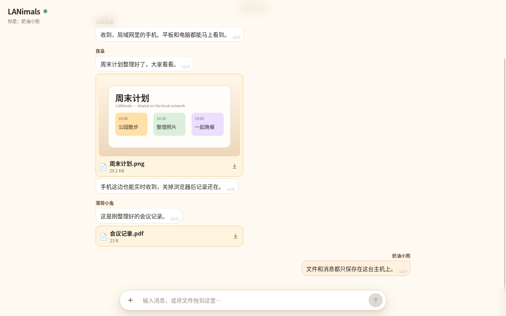
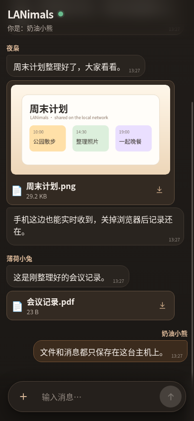
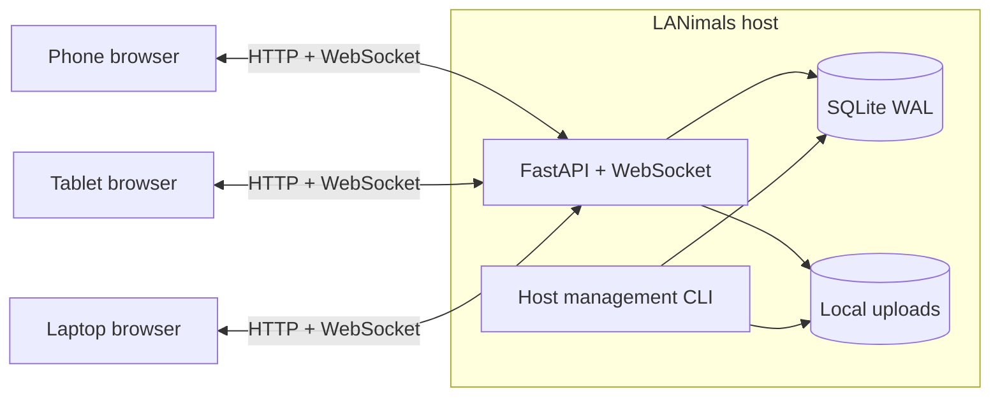

<div align="center">
  
  <h1>LANimals</h1>
  <p><strong>Self-hosted LAN chat and file sharing — send messages and files between phone and PC over Wi‑Fi, from any browser, with no internet, no app, and no account.</strong></p>
  <p>One host. One room. Every device on your local network.</p>

  <p>
    
    
    
    
    
    
    <a href="LICENSE"></a>
    <a href="https://github.com/sleepyquq/LANimals/releases/latest"></a>
  </p>

  <p>
    <strong>English</strong> · <a href="README.zh-CN.md">简体中文</a>
  </p>
</div>

---

**LANimals** is an open-source, self-hosted local network chat room and file transfer tool. Run it on one Windows, macOS, or Linux computer; every iPhone, Android phone, iPad, tablet, or laptop on the same Wi‑Fi or LAN opens the host's address in a web browser, enters the shared room password, and can immediately send text, photos, videos, and files of any type. Nothing leaves your network: it works fully offline, needs no client app, no sign-up, and no cloud server, and keeps the full message and file history on the host across restarts.

If LocalSend handles a one-off transfer, LANimals keeps the conversation around it.

## Product preview

These screenshots come from the real application running against a temporary preview database. The desktop view uses the light theme; the phone view follows the system dark theme.

<table>
  <tr>
    <td width="68%"><a href="docs/assets/lanimals-desktop-light.png"></a></td>
    <td width="32%"><a href="docs/assets/lanimals-mobile-dark.png"></a></td>
  </tr>
  <tr>
    <td align="center">Desktop · light</td>
    <td align="center">Mobile · dark</td>
  </tr>
</table>

## At a glance

| | |
|---|---|
| **What** | Self-hosted group chat + file sharing for one local network (LAN / Wi‑Fi) |
| **Host** | Windows, macOS, or Linux — prebuilt app or Python 3.11+ |
| **Clients** | Any modern browser: iOS, Android, iPadOS, Windows, macOS, Linux, ChromeOS — nothing to install |
| **Internet needed** | No. Runs offline; no CDN, telemetry, analytics, or cloud storage |
| **Accounts** | None. One shared room password; each device gets an animal nickname |
| **History** | Persistent: SQLite on the host, uploaded files on the host disk |
| **Join** | `http://lanimals.local:8787/` (mDNS) or the host's LAN IP, or scan the QR code |
| **File size** | Any file type; default limit 2 GB per upload, configurable on the host |
| **Encryption** | Optional HTTPS with a self-signed certificate for untrusted Wi‑Fi |
| **Stack** | FastAPI, WebSocket, SQLite (WAL), plain HTML/CSS/JS, PySide6 desktop control panel |

## Use cases

- **Send files from phone to computer and back** — iPhone to Windows PC, Android to Mac, iPad to Linux — without cables, Bluetooth, email, or a cloud drive.
- **A cross-platform AirDrop alternative** that works between Apple and non-Apple devices, from the browser.
- **A private "send to self" / note-to-self channel** across your own devices, like a self-hosted WeChat File Transfer or Telegram Saved Messages that never leaves your LAN.
- **Share files in a home, office, classroom, lab, or meeting room** where everyone is on the same Wi‑Fi but you do not want a public chat app.
- **Offline or air-gapped networks** with no Internet connection — LAN parties, events, field sites, travel routers.
- **Keep a persistent history** of what was shared, instead of one-off transfers that disappear.

## How it compares

| | LANimals | LocalSend | PairDrop / Snapdrop | AirDrop | Mattermost / Rocket.Chat |
|---|---|---|---|---|---|
| Client needs | Browser only | App on each device | Browser only | Apple devices only | Browser or app + account |
| Persistent chat + file history | ✅ | — | — | — | ✅ |
| Group room for many devices | ✅ | — | — | — | ✅ |
| Works with no Internet | ✅ | ✅ | Only if self-hosted | ✅ | If self-hosted |
| Setup weight | One process, one folder | Install per device | Server for signaling | Built in | Server + database + users |

Pick LocalSend or PairDrop for quick one-off transfers. Pick LANimals when you want a lightweight shared room where the files and the conversation around them stay on your own machine.

## Download

Prebuilt apps for every release are on the [**Releases page**](https://github.com/sleepyquq/LANimals/releases/latest):

| Platform | File |
|---|---|
| Windows x64 | `LANimals-windows-x64.zip` — unzip and run `LANimals.exe` |
| macOS | `LANimals-macos.zip` |
| Linux x64 | `LANimals-linux-x64.tar.gz` |

The app opens a desktop control panel that shows the join QR code. Only the host needs it — other devices just open the address in a browser. To run from source instead, see [Quick start](#quick-start).

## What it does

- **One shared room** — no accounts, channels, contact lists, or setup on client devices.
- **Messages and files together** — send text, one or more attachments, or both in the same message.
- **Persistent local history** — SQLite stores messages and attachment metadata; uploaded files stay on the host disk.
- **Realtime updates** — WebSocket delivery keeps every open browser in sync.
- **Friendly device identities** — regular browsers keep a cute animal name; temporary sessions use a separate mysterious-animal identity.
- **Browser-only clients** — phones and tablets do not need an app.
- **Automatic light and dark themes** — the interface follows `prefers-color-scheme` and falls back to light mode.
- **English and Simplified Chinese** — the browser language selects the initial interface language, with English as the fallback.
- **Host-only administration** — password changes, storage limits, and destructive cleanup stay in the local desktop control panel or terminal, never in a browser client.
- **No cloud dependency at runtime** — the application uses no CDN, analytics, telemetry, advertising, or remote storage.

## How it works



The host automatically looks for a private RFC1918 address (`10.x`, `172.16-31.x`, or `192.168.x`). If it cannot find one, it binds to `127.0.0.1` instead of exposing the service on an unknown interface. When available, LANimals advertises `lanimals.local` over mDNS and prints a join QR code in the terminal.

## Quick start

Run from source (or use a [prebuilt download](#download)):

### Linux / macOS

```bash
git clone https://github.com/sleepyquq/LANimals.git
cd LANimals

python3 -m venv .venv
.venv/bin/python -m pip install -r requirements.txt
.venv/bin/python -m lanimals
```

### Windows PowerShell

```powershell
git clone https://github.com/sleepyquq/LANimals.git
cd LANimals

py -3.11 -m venv .venv
.\.venv\Scripts\python.exe -m pip install -r requirements.txt
.\.venv\Scripts\python.exe -m lanimals
```

On the first run, LANimals asks you to create the shared room password. Choose option **1** in the host menu to start the chat. The terminal then prints a join address and QR code, for example:

```text
http://lanimals.local:8787/
http://192.168.x.x:8787/
```

Open that address from any device on the same LAN. On Windows, allow Python through the firewall for **private networks only**.

### Native desktop control panel

For a host-local graphical control panel, run:

```bash
.venv/bin/python -m lanimals gui
```

On Windows PowerShell, use:

```powershell
.\.venv\Scripts\python.exe -m lanimals gui
```

The desktop app shows the join QR code and keeps local administration on the host. The LAN access switch next to the title applies immediately; the settings page holds adapter selection, the fixed-domain and HTTPS switches, upload limit, password rotation, and a guarded clear-data action. Settings are saved together and restart the local service once; destructive cleanup requires typing `DELETE ALL` in an in-window confirmation card.

## Host management

Run the menu again from the machine that stores the data.

Linux / macOS:

```bash
.venv/bin/python -m lanimals
```

Windows PowerShell:

```powershell
.\.venv\Scripts\python.exe -m lanimals
```

Direct commands are also available. The examples below use the Linux/macOS interpreter path; on Windows PowerShell, replace `.venv/bin/python` with `.\.venv\Scripts\python.exe`.

```bash
# Start the chat service
.venv/bin/python -m lanimals serve

# Change the shared password and revoke current sessions
.venv/bin/python -m lanimals password

# Change the upload limit
.venv/bin/python -m lanimals config --max-upload-size 2GB

# Delete all messages and uploaded files after local confirmation
.venv/bin/python -m lanimals clear
```

The web interface has no delete route, hidden admin panel, or remote cleanup button. The desktop control panel and the CLI are host-local only.

## Windows app and release builds

The packaged app opens the desktop control panel directly. Windows and Linux builds store runtime data beside the executable in `data/`; the macOS app stores it in `~/Library/Application Support/LANimals`, because the inside of an `.app` bundle may be read-only and is replaced on upgrade.

Build a local Windows portable folder with:

```powershell
.\.venv\Scripts\python.exe -m pip install -r requirements.txt
.\.venv\Scripts\python.exe scripts\build_app.py --mode onedir
Compress-Archive -Path dist\LANimals -DestinationPath dist\LANimals-windows-x64.zip -Force
```

The portable app is `dist/LANimals/LANimals.exe`; distribute the zip without adding a pre-existing `data/` directory.

For macOS and Linux, use the **Build and Release LANimals** workflow from the GitHub Actions tab. Its matrix builds the native artifact on each platform, uploads Windows/macOS/Linux artifacts for manual runs, and creates a release when a `v*` tag is pushed. PyInstaller must build on the target OS; do not cross-build those GUI artifacts from Windows.

To publish a release from the browser: bump `version` in `pyproject.toml` and merge it to `main`, then open **Actions → Build and Release LANimals → Run workflow**, choose `main`, and enter the version (for example `v0.3.0`). The workflow first checks the format, that it matches `pyproject.toml`, that the tag does not exist yet, and that the branch is `main`; it then builds and launch-checks all three platforms and creates the tag and release only if every build succeeded. Leaving the version empty only builds artifacts. Pushing a `v*` tag still works too.

Every push also runs the **CI** workflow on Windows, macOS, and Linux: the test suite, offscreen control-panel screenshots (Chinese, English, and dark theme; download the `gui-preview-<OS>` artifact from the run page), and a PyInstaller onedir build that is actually launched to confirm the local service answers. Both workflows run the same launch check before packaging; locally you can repeat it after a build with `python scripts/smoke_frozen.py --reset-data` (it clears and then removes the packaged app's data directory, so do not run it against data you want to keep).

## Data and backups

All runtime data lives under `data/` by default (the packaged macOS app uses `~/Library/Application Support/LANimals` instead):

```text
data/
├── config.toml    # host, port, upload limit, HTTPS switch, and scrypt password hash
├── chat.db        # identities, sessions, messages, and attachment metadata
├── tls/           # self-signed certificate, created only when HTTPS is enabled
└── uploads/       # uploaded file contents
```

Stop LANimals and copy the complete `data/` directory to make a consistent backup. The directory is ignored by Git and should never be committed.

## Security model

LANimals is built for a home or office LAN. It uses plain HTTP by default, which is fine on a network where you trust every device. On a shared or less trusted network (for example a dorm, office, or café Wi‑Fi), turn on **Encrypted (HTTPS)** in the desktop settings page: the host creates a self-signed certificate, and messages, files, and login cookies are encrypted so other devices on the network cannot read them. Each device sees a one-time browser certificate warning and has to choose to continue. If a device that already accepted the certificate suddenly warns again while the host's network has not changed, do not continue: someone may be impersonating the host.

LANimals is still not meant to be exposed directly to the public Internet. It has one shared password and a self-signed certificate, and automatic binding only uses private LAN addresses.

LANimals keeps these controls explicit:

- room passwords are stored as scrypt hashes, and new passwords need at least 8 characters;
- after 5 wrong passwords, a device is locked out for 30 seconds, doubling with each further miss up to 15 minutes;
- login sessions expire after 30 days, and devices keep their animal name when they sign in again;
- the optional HTTPS mode encrypts all traffic, including WebSocket updates;
- new uploads are refused while the host disk is nearly full (less than 10% free, at most 10 GB kept), and text messages keep working;
- session and identity cookies are opaque and `HttpOnly`;
- uploads are authenticated and size-checked before multipart parsing;
- downloads require an authenticated session;
- password rotation invalidates current sessions; connected WebSockets are closed before they can receive a later broadcast;
- destructive administration is available only from the host terminal;
- automatic network binding accepts private LAN addresses only.

## Project layout

```text
lanimals/
├── __main__.py       # management menu and command-line entry point
├── cli.py            # host-only administration
├── config.py         # TOML settings and password hashing
├── identity.py       # cookies, sessions, and animal names
├── limits.py         # pre-parser upload guards and disk-space reserve
├── main.py           # FastAPI routes and file handling
├── network.py        # LAN discovery, mDNS, and terminal QR code
├── realtime.py       # WebSocket fan-out
├── store.py          # SQLite persistence
├── throttle.py       # failed-login lockout
├── tls.py            # self-signed certificate for HTTPS mode
├── gui/              # PySide6 host-local desktop control panel
└── web/              # native HTML, CSS, JavaScript, and locale files

scripts/              # icon generation and PyInstaller build helper
.github/workflows/    # native Windows, macOS, and Linux build matrix
tests/                # pytest suite
data/                 # local runtime data; ignored by Git
```

## Development

```bash
python3 -m venv .venv
.venv/bin/python -m pip install -r requirements.txt
.venv/bin/python -m pytest -q
.venv/bin/python -m compileall -q lanimals tests
node --check lanimals/web/app.js
```

The frontend intentionally has no build step. Static HTML, CSS, JavaScript, and locale JSON files are packaged with the Python application.

## Current scope

LANimals is built for households and small offices. It currently has one room and does not provide public hosting, private messages, multiple channels, user accounts, message editing, per-message deletion, media transcoding, or multi-worker deployment.

## FAQ

**Does LANimals need an Internet connection?**
No. The host and the browsers only talk to each other over your local network. The app loads no CDN, fonts, analytics, or telemetry, so it works on an offline or air-gapped network.

**Do phones need to install an app?**
No. Any modern browser on iOS, Android, or a desktop works. Only the host computer runs LANimals.

**How do I send a file from my iPhone or Android phone to my PC?**
Start LANimals on the PC, scan the QR code it shows (or open `http://lanimals.local:8787/` or the printed IP address) on the phone, enter the room password, and attach the file. It appears instantly in every open browser, including the PC's.

**Is there a file size limit?**
The default is 2 GB per upload; change it on the host with `python -m lanimals config --max-upload-size 10GB` or in the desktop settings. New uploads pause when the host disk is nearly full.

**Is it safe on public or shared Wi‑Fi?**
Turn on **Encrypted (HTTPS)** in the desktop settings so traffic is encrypted with a self-signed certificate. See the [security model](#security-model). Do not expose LANimals to the public Internet.

**Where are messages and files stored? How do I back them up?**
On the host only, in the `data/` folder (macOS app: `~/Library/Application Support/LANimals`). Stop the app and copy the folder. See [Data and backups](#data-and-backups).

**Can I delete messages from a phone?**
No, by design. Browser clients have no delete or admin features; cleanup happens only on the host.

## License

[MIT](LICENSE) — free to use, modify, and redistribute.
