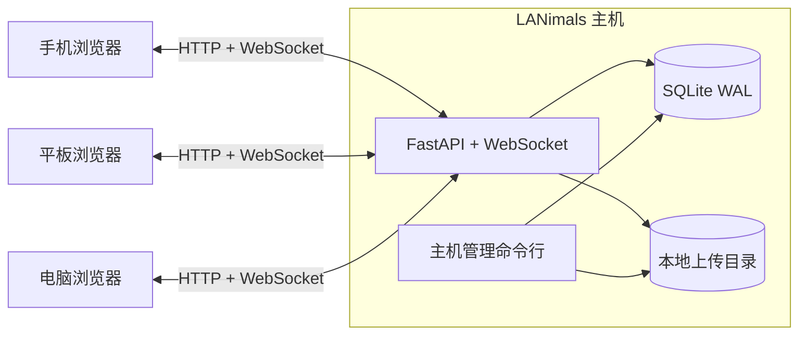

<div align="center">
  
  <h1>LANimals</h1>
  <p><strong>自托管的局域网聊天与文件互传工具：手机和电脑在同一 Wi‑Fi 下用浏览器互发消息和文件，无需联网、无需装 App、无需注册账号。</strong></p>
  <p>一台主机，一个房间，连接局域网里的所有设备。</p>

  <p>
    
    
    
    
    
    
    <a href="https://github.com/sleepyquq/LANimals/releases/latest"></a>
  </p>

  <p>
    <a href="README.md">English</a> · <strong>简体中文</strong>
  </p>
</div>

---

**LANimals** 是一个开源、自托管的局域网聊天室和文件传输工具（内网聊天 / 局域网文件共享）。在一台 Windows、macOS 或 Linux 电脑上运行它，同一 Wi‑Fi 或局域网里的 iPhone、安卓手机、iPad、平板和笔记本，只要用浏览器打开主机地址、输入共享房间密码，就能立即互发文字、照片、视频和任意类型的文件。数据不出局域网：完全离线可用，客户端不用装 App、不用注册、不经过任何云服务器，消息和文件历史保存在主机上，重启后依然存在。

如果 LocalSend 适合一次性传输文件，LANimals 则保留文件前后的对话。

## 产品预览

以下截图来自真实运行的 LANimals，数据由临时预览数据库生成。电脑端使用浅色主题，手机端跟随系统深色主题。

<table>
  <tr>
    <td width="68%"><a href="docs/assets/lanimals-desktop-light.png"></a></td>
    <td width="32%"><a href="docs/assets/lanimals-mobile-dark.png"></a></td>
  </tr>
  <tr>
    <td align="center">电脑端 · 浅色</td>
    <td align="center">手机端 · 深色</td>
  </tr>
</table>

## 一览

| | |
|---|---|
| **是什么** | 面向单个局域网（LAN / Wi‑Fi）的自托管群聊 + 文件互传 |
| **主机** | Windows、macOS 或 Linux —— 下载打包好的应用，或用 Python 3.11+ 运行源码 |
| **客户端** | 任意现代浏览器：iOS、Android、iPadOS、Windows、macOS、Linux、ChromeOS，无需安装 |
| **是否需要外网** | 不需要。离线可用，不使用 CDN、遥测、统计或云存储 |
| **账号** | 没有账号。一个共享房间密码，每台设备自动获得一个动物昵称 |
| **历史记录** | 持久保存：SQLite 在主机上，上传文件在主机磁盘上 |
| **加入方式** | `http://lanimals.local:8787/`（mDNS）、主机局域网 IP，或扫描二维码 |
| **文件大小** | 支持任意文件类型；默认单次上传上限 2 GB，可在主机上修改 |
| **加密** | 可选 HTTPS（自签名证书），适合不完全可信的 Wi‑Fi |
| **技术栈** | FastAPI、WebSocket、SQLite（WAL）、原生 HTML/CSS/JS、PySide6 桌面控制面板 |

## 适用场景

- **手机和电脑互传文件**：iPhone 传 Windows 电脑、安卓传 Mac、iPad 传 Linux，不用数据线、蓝牙、邮箱或网盘，也不用经过微信/QQ 压缩。
- **跨平台的 AirDrop（隔空投送）替代品**：苹果和非苹果设备之间直接用浏览器互传。
- **自己设备之间的“文件传输助手”**：像微信文件传输助手，但完全自托管，数据不离开局域网。
- **家庭、办公室、教室、实验室、会议室共享文件**：大家连着同一个 Wi‑Fi，又不想用公网聊天软件。
- **没有外网的内网或离线环境**：内网办公、局域网联机、活动现场、外出用的便携路由器。
- **类似飞秋 / 飞鸽传书的局域网群聊**，但所有设备只需要浏览器，聊天和文件记录长期保存。

## 和同类工具对比

| | LANimals | LocalSend | PairDrop / Snapdrop | AirDrop 隔空投送 | Mattermost / Rocket.Chat |
|---|---|---|---|---|---|
| 客户端要求 | 只要浏览器 | 每台设备装 App | 只要浏览器 | 仅限苹果设备 | 浏览器或 App + 账号 |
| 持久保存聊天和文件记录 | ✅ | — | — | — | ✅ |
| 多设备共享群聊房间 | ✅ | — | — | — | ✅ |
| 无外网可用 | ✅ | ✅ | 需自行部署 | ✅ | 需自行部署 |
| 部署负担 | 一个进程、一个文件夹 | 每台设备安装 | 需要信令服务器 | 系统内置 | 服务器 + 数据库 + 用户管理 |

只是临时传一次文件，LocalSend 或 PairDrop 更合适；想要一个轻量的共享房间，让文件和围绕它的对话都留在自己的电脑上，就用 LANimals。

## 下载

每个版本的打包应用都在 [**Releases 页面**](https://github.com/sleepyquq/LANimals/releases/latest)：

| 平台 | 文件 |
|---|---|
| Windows x64 | `LANimals-windows-x64.zip` —— 解压后运行 `LANimals.exe` |
| macOS | `LANimals-macos.zip` |
| Linux x64 | `LANimals-linux-x64.tar.gz` |

应用会打开一个桌面控制面板并显示加入二维码。只有主机需要安装，其他设备用浏览器打开地址即可。想从源码运行，请看[快速开始](#快速开始)。

## 功能

- **单一共享房间**：没有账号、频道、联系人或客户端配置。
- **消息与文件一起发送**：支持纯文字、多个附件，以及文字和附件组合消息。
- **本地持久化历史**：SQLite 保存消息和附件元数据，文件内容保存在主机磁盘。
- **实时同步**：WebSocket 让所有已打开的浏览器立即看到新消息。
- **可爱动物身份**：普通浏览器长期保留动物名称；临时模式使用独立的神秘动物身份。
- **客户端只需浏览器**：手机和平板无需安装 App。
- **自动浅色与深色主题**：界面读取 `prefers-color-scheme`，无法读取时回退为浅色。
- **简体中文与英文**：首次打开时根据浏览器语言选择界面，不支持的语言回退到英文。
- **管理操作只在主机上执行**：修改密码、上传上限和清空数据只在本地桌面控制面板或终端执行，浏览器客户端永远没有管理入口。
- **应用运行时不依赖云服务**：程序运行期间不使用 CDN、统计、遥测、广告或远程存储。

## 工作方式



主机会自动寻找 RFC1918 私有地址（`10.x`、`172.16-31.x` 或 `192.168.x`）。如果找不到，它只绑定 `127.0.0.1`，不会监听未知网络接口。条件允许时，LANimals 会通过 mDNS 广播 `lanimals.local`，并在终端打印加入二维码。

## 快速开始

从源码运行（也可以直接[下载打包好的应用](#下载)）：

### Linux / macOS

```bash
git clone https://github.com/sleepyquq/LANimals.git
cd LANimals

python3 -m venv .venv
.venv/bin/python -m pip install -r requirements.txt
.venv/bin/python -m lanimals
```

### Windows PowerShell

```powershell
git clone https://github.com/sleepyquq/LANimals.git
cd LANimals

py -3.11 -m venv .venv
.\.venv\Scripts\python.exe -m pip install -r requirements.txt
.\.venv\Scripts\python.exe -m lanimals
```

首次运行时，LANimals 会要求创建共享房间密码。在主机菜单中选择 **“启动聊天室”**，终端随后会显示加入地址和二维码，例如：

```text
推荐访问: http://lanimals.local:8787/
备用地址: http://192.168.x.x:8787/
```

同一局域网内的设备打开该地址即可加入。Windows 第一次弹出防火墙提示时，只允许 Python 在**专用网络**中通信。

### 原生桌面控制面板

要打开仅供主机使用的图形控制面板，请运行：

```bash
.venv/bin/python -m lanimals gui
```

Windows PowerShell：

```powershell
.\.venv\Scripts\python.exe -m lanimals gui
```

桌面端会显示加入二维码，所有管理操作都只在主机上进行。标题旁的局域网访问拨杆切换后立即生效；设置页包含网卡选择、固定域名与 HTTPS 开关、上传上限、修改密码和清除数据。设置会一起保存，并且只重启一次本地服务；清除数据必须在窗口内的确认卡片中精确输入 `DELETE ALL`。

## 主机管理

在保存数据的电脑上再次运行菜单。

Linux / macOS：

```bash
.venv/bin/python -m lanimals
```

Windows PowerShell：

```powershell
.\.venv\Scripts\python.exe -m lanimals
```

也可以直接使用子命令。下面的示例采用 Linux/macOS 路径；在 Windows PowerShell 中，把 `.venv/bin/python` 替换为 `.\.venv\Scripts\python.exe`。

```bash
# 启动聊天室
.venv/bin/python -m lanimals serve

# 修改共享密码并撤销当前会话
.venv/bin/python -m lanimals password

# 修改上传大小上限
.venv/bin/python -m lanimals config --max-upload-size 2GB

# 本地确认后删除全部消息和上传文件
.venv/bin/python -m lanimals clear
```

网页端没有删除接口、隐藏管理面板或远程清空按钮。桌面控制面板与 CLI 都只能在主机本地运行。

## Windows 应用与发布构建

打包后的程序会直接打开桌面控制面板。Windows 和 Linux 版把运行数据保存在可执行文件同级的 `data/` 目录；macOS 版保存在 `~/Library/Application Support/LANimals`，因为 `.app` 包内部可能是只读的，并且升级时会被整体替换。

本机构建 Windows 便携版：

```powershell
.\.venv\Scripts\python.exe -m pip install -r requirements.txt
.\.venv\Scripts\python.exe scripts\build_app.py --mode onedir
Compress-Archive -Path dist\LANimals -DestinationPath dist\LANimals-windows-x64.zip -Force
```

便携版入口为 `dist/LANimals/LANimals.exe`。分发 zip 时不要带入已经存在的 `data/` 目录。

macOS 和 Linux 请在 GitHub Actions 页面手动运行 **Build and Release LANimals**。工作流会在各自的原生 runner 上构建并上传 Windows/macOS/Linux 产物；推送 `v*` 标签时会创建 Release。PyInstaller 的 GUI 产物必须在目标系统构建，不应从 Windows 交叉构建。

在网页上发布新版本：先把 `pyproject.toml` 的 `version` 改好并合并到 `main`，再打开 **Actions → Build and Release LANimals → Run workflow**，分支选 `main`，填写版本号（如 `v0.3.0`）。工作流会先校验格式、与 `pyproject.toml` 是否一致、标签是否已存在以及分支是否为 `main`；随后在三个平台打包并实际启动检查，全部成功才创建标签和 Release。版本号留空则只打包不发布；推送 `v*` 标签的方式依然可用。

每次推送还会在 Windows、macOS、Linux 上运行 **CI** 工作流：执行测试、离屏生成控制面板截图（中文、英文和深色主题，可在运行页面下载 `gui-preview-<系统>` 附件），并用 PyInstaller 打出文件夹版后真正启动一次，确认本地服务能正常响应。两个工作流在打包前都会做这项启动检查；本机构建后也可以运行 `python scripts/smoke_frozen.py --reset-data` 复现（它会清空并在结束后删除打包版的数据目录，不要对仍需保留的数据运行）。

## 数据与备份

运行数据默认保存在 `data/`（macOS 打包版为 `~/Library/Application Support/LANimals`）：

```text
data/
├── config.toml    # 主机、端口、上传上限、HTTPS 开关与 scrypt 密码哈希
├── chat.db        # 身份、会话、消息与附件元数据
├── tls/           # 自签名证书，只在开启 HTTPS 后生成
└── uploads/       # 实际上传文件
```

停止 LANimals 后，复制完整的 `data/` 目录即可获得一致的备份。该目录已被 Git 忽略，不能提交到仓库。

## 安全边界

LANimals 面向家庭或办公局域网。默认使用普通 HTTP，适合网络里每台设备都可信任的场景。如果在宿舍、公司、咖啡店等共用或不完全可信的 Wi‑Fi 中使用，请在桌面端设置页打开 **加密连接 (HTTPS)**：主机会生成自签名证书，消息、文件和登录 Cookie 都会加密传输，同一网络里的其他设备无法读取。每台设备首次打开时浏览器会提示一次证书警告，需要选择继续访问。已经确认过证书的设备如果在主机网络没有变化的情况下再次出现警告，请不要继续，可能有人在冒充主机。

LANimals 仍然不适合直接暴露到公网：它只有一个共享密码，使用的是自签名证书，自动绑定也只会选择私有局域网地址。

LANimals 明确执行以下控制：

- 共享密码只保存为 scrypt 哈希，新设置的密码至少 8 位；
- 连续输错 5 次密码后，该设备会被锁定 30 秒，之后每多错一次锁定时间翻倍，最长 15 分钟；
- 登录会话 30 天后过期，重新登录后动物名称保持不变；
- 可选的 HTTPS 模式会加密全部流量，包括 WebSocket 实时消息；
- 主机硬盘快满时（剩余低于 10%，最多保留 10 GB）会自动拒绝新的上传，文字消息不受影响；
- 会话与身份 Cookie 是不透明随机值，并设置 `HttpOnly`；
- 上传在 multipart 解析前完成身份与原始请求大小检查；
- 下载文件需要有效会话；
- 修改密码会使当前会话失效；已连接的 WebSocket 会在收到后续广播前被关闭；
- 破坏性管理操作只存在于主机本地终端；
- 自动网络绑定只接受私有局域网地址。

## 项目结构

```text
lanimals/
├── __main__.py       # 管理菜单与命令行入口
├── cli.py            # 主机本地管理
├── config.py         # TOML 配置与密码哈希
├── identity.py       # Cookie、会话与动物名称
├── limits.py         # multipart 解析前的上传保护与磁盘余量检查
├── main.py           # FastAPI 路由与文件处理
├── network.py        # 局域网发现、mDNS 与终端二维码
├── realtime.py       # WebSocket 广播
├── store.py          # SQLite 持久化
├── throttle.py       # 密码错误锁定
├── tls.py            # HTTPS 模式的自签名证书
├── gui/              # PySide6 主机本地桌面控制面板
└── web/              # 原生 HTML、CSS、JavaScript 与语言资源

scripts/              # 图标生成与 PyInstaller 打包脚本
.github/workflows/    # Windows、macOS、Linux 原生构建矩阵
tests/                # pytest 测试
data/                 # 本地运行数据；Git 已忽略
```

## 开发与测试

```bash
python3 -m venv .venv
.venv/bin/python -m pip install -r requirements.txt
.venv/bin/python -m pytest -q
.venv/bin/python -m compileall -q lanimals tests
node --check lanimals/web/app.js
```

前端刻意不设置构建步骤。原生 HTML、CSS、JavaScript 和语言 JSON 文件会随 Python 包一起发布。

## 当前范围

LANimals 面向家庭和小型办公室。目前只提供一个共享房间，不提供公网托管、私聊、多频道、用户账号、消息编辑、逐条删除、媒体转码或多进程 Worker 部署。

## 常见问题

**需要连外网吗？**
不需要。主机和浏览器只在局域网内通信，程序不加载任何 CDN、字体、统计或遥测，所以在断网或物理隔离的内网中也能用。

**手机需要装 App 吗？**
不需要。iOS、Android 或电脑上的任意现代浏览器都可以。只有主机电脑需要运行 LANimals。

**怎么把 iPhone / 安卓手机上的文件传到电脑？**
在电脑上启动 LANimals，用手机扫描它显示的二维码（或打开 `http://lanimals.local:8787/`、终端打印的 IP 地址），输入房间密码后选择附件发送。文件会立刻出现在所有已打开的浏览器里，包括电脑上的。

**文件大小有限制吗？**
默认单次上传 2 GB，可以在主机上用 `python -m lanimals config --max-upload-size 10GB` 或桌面设置页修改。主机磁盘快满时会暂停接收新上传。

**在公共或共享 Wi‑Fi 上安全吗？**
在桌面设置中打开 **加密连接 (HTTPS)**，流量会用自签名证书加密。详见[安全边界](#安全边界)。不要把 LANimals 直接暴露到公网。

**消息和文件存在哪里？怎么备份？**
只存在主机的 `data/` 目录里（macOS 应用为 `~/Library/Application Support/LANimals`）。停止应用后复制整个目录即可。详见[数据与备份](#数据与备份)。

**能在手机上删除消息吗？**
不能，这是有意的设计。浏览器客户端没有删除或管理功能，清理只能在主机上进行。
